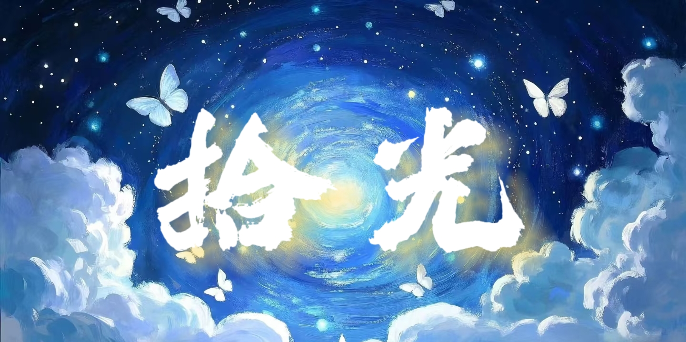
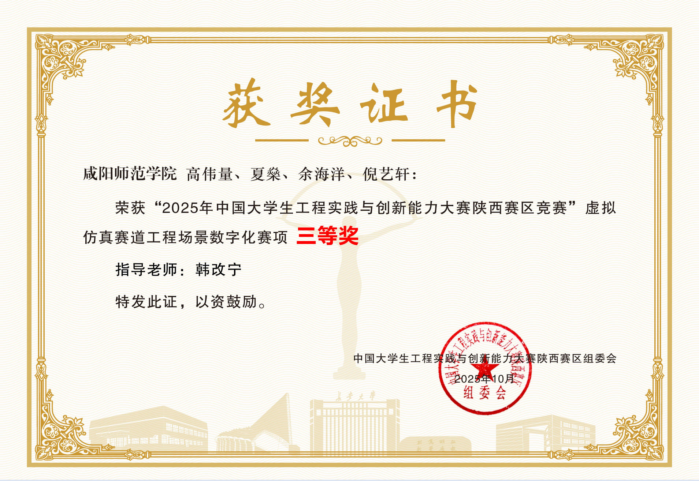
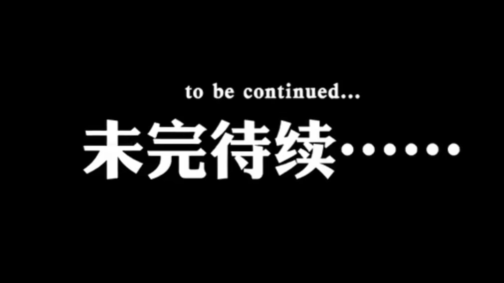

<div align="center">



# 拾光 · Picking Up the Light

**一款以「盲人视角」为主题的 3D 叙事解谜小游戏**

`Unity 2022.3 LTS` · `C# + Visual Scripting` · `Built-in Render Pipeline` · `Windows`


[项目简介](#一这是什么) · [获奖情况](#二获奖情况) · [玩法机制](#四玩法机制) · [技术实现](#五技术选型) · [快速开始](#九快速开始) · [下载试玩](https://github.com/xs2580/shiguang/releases/latest)

</div>

---

## 一、这是什么

《拾光》是一个** Windows 平台的 Unity 3D 叙事解谜游戏**。

玩家扮演一位**先天性失明的小女孩**。某个夜晚，一股神秘的力量降临在她的梦里，答应每天给她 **15 分钟的光明**——条件是这段时光必须让她和这股力量都感到幸福；如果她感到痛苦，光明就会被收回。

玩家要做的就是：**用手里的 15 分钟，一点一点重新认识自己最熟悉的房间、最熟悉的饭菜、最熟悉的一切**——只不过这一次，是「看见」。

> 灵感来自海伦·凯勒的《假如给我三天光明》。我们把它改写成「假如每天给我十五分钟光明」。

这个项目的目标不是「做一个好玩的游戏」，而是**用沉浸式的 3D 场景 + 温柔的叙事，让视力正常的玩家短暂地代入盲人的世界**：当你在漆黑中摸索着找到餐桌、在模糊的视野里辨认出一盘菜、在回忆起味道的瞬间被点亮——你会开始理解，那份我们习以为常的光明，究竟有多珍贵。

### 一句话卖点

| 维度 | 说明 |
| --- | --- |
| **题材** | 罕见地选择「残障关怀 / 视障体验」作为核心主题，而非打怪升级 |
| **核心机制** | 「每天 15 分钟光明」——把「光」本身做成了有限资源，玩家的每次观察都在消耗它 |
| **表现形式** | 3D 写实场景（卧室 / 餐厅）＋ 图文叙事 ＋ 物品回忆触发 |
| **情感落点** | 不靠说教，靠「让你亲身体验一次看不见」来唤起共情 |
| **技术路线** | Unity 2022.3 LTS ＋ 可视化脚本驱动交互逻辑，快速原型迭代 |

---

## 二、获奖情况

本项目参加了 **2025 年中国大学生工程实践与创新能力大赛**，成绩如下：

> **陕西赛区竞赛 · 虚拟仿真赛道 · 工程场景数字化赛项 —— 三等奖**

<table>
<tr>
<td width="50%"></td>
<td width="50%">
<p><b>参赛单位：</b>咸阳师范学院</p>
<p><b>团队成员：</b>高伟量、夏燊、余海洋、倪艺轩</p>
<p><b>指导老师：</b>韩改宁</p>
<p><b>获奖时间：</b>2025 年 10 月</p>
<p><b>颁发单位：</b>中国大学生工程实践与创新能力大赛陕西赛区组委会</p>
<hr>
<p><b>赛项定位：</b>「工程场景数字化」赛项考察的是——把真实工程 / 生活场景用数字化手段还原并赋予交互的能力。本项目选择还原「视障人士的居家生活场景」，在场景写实度、交互完整度与人文立意上都做了探索。</p>
</td>
</tr>
</table>

---

## 三、故事设定与创作立意

### 3.1 剧情梗概

```
                 ┌──────────────────────────────────────────┐
                 │  场景一 · 清醒梦                          │
                 │  漆黑之中亮起白色的字，女孩第一次"读"到   │
                 │  一个声音：                              │
                 │  「你想要见到光明吗？我可以每天为你带来   │
                 │    十五分钟的光明，当然前提是你能让我满意」│
                 └────────────────────┬─────────────────────┘
                                      │ 接受契约
                                      ▼
                 ┌──────────────────────────────────────────┐
                 │  场景二 · 卧室                            │
                 │  从梦中醒来，睁眼看见最熟悉的卧室。       │
                 │  按视野中的指引，选取不同物件仔细观察，   │
                 │  回忆起过去与它们的互动 → 推动剧情       │
                 └────────────────────┬─────────────────────┘
                                      │
                                      ▼
                 ┌──────────────────────────────────────────┐
                 │  场景三 · 餐厅                            │
                 │  父母已出门上班，餐桌上摆着他们准备好的   │
                 │  早饭。凭提示走到餐桌前，逐道品尝，       │
                 │  回忆起熟悉的味道 → 第一章结束           │
                 └────────────────────┬─────────────────────┘
                                      │
                                      ▼
                              「未完待续……」  ← 第二章：走出家门
```

### 3.2 为什么要做这个

国内大多数学生游戏作品集中在「射击 / 跑酷 / 塔防」这类强玩法品类，而《拾光》想尝试另一种可能：**用游戏独有的交互性去承载一次「共情训练」**。

- **盲人的痛苦很难被想象**。我们看得见，所以无法真正体会「看不见」是什么感觉。与其用文字描述，不如让玩家亲自操作一次——在几乎全黑的画面里，用鼠标一点一点摸索出物体的轮廓、用听感和记忆去判断方向。
- **「15 分钟」这个设定本身就是隐喻**。视力对大多数人是「无限期拥有」的，但对某些人是「限时体验」的。把光明做成会消耗的资源，玩家在每一次点击观察时都会有轻微的「舍不得」，这就是设计的意图。
- **父母的爱藏在细节里**。餐厅那一幕里，父母已经上班去了，桌上留着早饭——这是全篇最温柔的一笔：你看不见的时候，爱是被做成了饭菜摆在你面前的。

> 正如作品文档里写的：
> *「引导科普玩家了解到残疾人的生活，让玩家理解到，这份普普通通的光明这样的得之不易，进而自发的去保护自己、关爱残疾人。」*

---

## 四、玩法机制

| 机制 | 实现方式 | 说明 |
| --- | --- | --- |
| **黑暗视野 / 光明限制** | 场景相机 + UI 遮罩 / 亮度控制 | 「每天 15 分钟」的核心表现，用界面与视野的明暗变化传达 |
| **鼠标射线交互** | `Physics.Raycast` 从屏幕点发射线 | 玩家用鼠标点击场景中的物体来「触摸 / 观察」 |
| **物品回忆触发** | `SceneLoader` 组件 + 弹窗 | 点击可交互物件 → 弹出图文面板，讲述该物件承载的记忆 |
| **选择 / 分支反馈** | Animator 状态机切换 | 左键「go」/ 右键「no」（W/S 键同义），用动画表现角色的接受或拒绝 |
| **场景推进** | `SceneManager.LoadScene` | 完成一个场景的全部交互后，加载下一场景 |
| **退出** | `Application.Quit()` | 主菜单 / 结束页提供退出按钮 |

---

## 五、技术选型

| 层级 | 技术 | 版本 / 说明 |
| --- | --- | --- |
| **引擎** | Unity | **2022.3.56f1c1**（Unity 2022 LTS 长期支持版，中国版发行号带 `c1`） |
| **渲染管线** | Built-in Render Pipeline | 使用引擎内置渲染管线（未引入 URP / HDRP），保证兼容性与构建体积 |
| **编程语言** | C# | 用于交互逻辑、场景跳转、退出等系统级功能 |
| **逻辑编排** | Visual Scripting | `com.unity.visualscripting 1.9.4`——**项目的主要逻辑由可视化脚本图驱动**，降低美术 / 策划的参与门槛 |
| **过场与时间轴** | Timeline | `com.unity.timeline 1.7.6`，用于编排剧情演出与镜头 |
| **UI 系统** | uGUI + TextMesh Pro | `com.unity.ugui 1.0.0` + `com.unity.textmeshpro 3.0.7`，中文文本由 TMP 渲染，字形更清晰 |
| **动画** | Animator Controller | `UnityEngine.AnimationModule`，状态机 + 4 个动画片段（`go` / `go1` / `no` / `no1`） |
| **物理** | Unity Physics | 用于鼠标拾取射线（`Physics.Raycast`）与碰撞检测 |
| **版本控制** | Git + GitHub | `com.unity.collab-proxy 2.7.1` 也在依赖中，但实际使用 Git 托管 |
| **目标平台** | Windows x64 | 构建产物为 `拾光.exe` + `拾光_Data`，Mono 脚本后端 |

### 5.1 为什么用 Visual Scripting

这是学生团队在有限工期内做的**务实选择**：

- 团队成员并非都是程序员，Visual Scripting 让策划 / 美术也能直接搭建交互流程（点哪个物体、弹哪张图、进哪个场景），不写代码也能改逻辑；
- 原型阶段改需求极频繁，图形化脚本的「连线即生效」比改 C# 再等编译快得多；
- C# 只保留那些真正需要代码的场景：射线拾取、场景加载、退出等。

所以你会看到工程里 C# 脚本只有 5 个、`Assembly-CSharp.dll` 编译后仅 68 KB，而交互逻辑大量分布在 `.asset`（Visual Scripting Graph）与 `.prefab` 中。

---

## 六、工程结构

> 下面是仓库的完整目录结构（已排除 `Library/` 等生成目录）。带 **`◆`** 的是项目自有的核心内容，带 **`▸`** 的是第三方资源包。

```
My project 4/                         ← Unity 工程根目录
├── Assets/                           ← 所有游戏资源
│   ├── ◆ Scenes/
│   │   ├── SampleScene.unity         ★ 主场景（Build Settings 中唯一启用的场景）
│   │   └── Initialization.unity      ▸ 初始化空场景
│   │
│   ├── ◆ FALES/
│   │   └── InteractableObject.cs     ★ 通用交互组件（类名 SceneLoader）
│   │
│   ├── ◆ beer.cs                     ★ 点击物体 → 激活指定 Canvas（物品详情弹窗）
│   ├── ◆ control.cs                  ★ 鼠标左/右键 → 播放 go / no 动画
│   ├── ◆ control1.cs                 ★ 键盘 W/S 键 → 播放 go1 / no1 动画
│   ├── ◆ TuiChu.cs                   ★ 「退出游戏」按钮逻辑
│   │
│   ├── ◆ Canvas.prefab               ★ 主 UI 面板
│   ├── ◆ Canvas 1.prefab             ★ 物品详情 / 回忆弹窗面板
│   ├── ◆ Canvasend.prefab            ★ 「未完待续」结束页
│   │
│   ├── ◆ go.anim / go1.anim          ★ 「接受 / 前进」动画片段
│   ├── ◆ no.anim / no1.anim          ★ 「拒绝 / 摇头」动画片段
│   ├── ◆ New Animator Controller1.controller
│   ├── ◆ New Animator Controller2.controller
│   ├── ◆ obj_3d66-Editable_mesh-20407534-012.controller
│   │
│   ├── ◆ shiguang.jpg                ★ 游戏主视觉（封面 / 首页背景）
│   ├── ◆ end.jpg                     ★ 「未完待续」结束图
│   ├── ◆ Materials/新建渲染器纹理1.mat
│   │
│   ├── ▸ 卧室1.fbx  /  卧室1.fbm/     第三方卧室场景模型（已排除出仓库，见第十节）
│   ├── ▸ 餐厅.fbx   /  餐厅.fbm/      第三方餐厅场景模型（已排除出仓库，见第十节）
│   ├── ▸ 菜1.fbx    /  菜1.fbm/       第三方菜品模型（已排除出仓库，见第十节）
│   │
│   ├── ▸ Freeui/                     免费 UI 素材包（FreeUI + ZOSMA）
│   │   ├── Main.unity / Set.unity / Stage.unity / FreeUI.unity   UI 示例场景（未启用）
│   │   └── ZOSMA/                    UI 切图（按钮 / 底板 / 图标等）
│   │
│   └── ▸ TextMesh Pro/               TMP 官方资源（字体、Shader、示例，未改动）
│
├── ProjectSettings/                  ← Unity 工程配置（必传）
│   ├── ProjectVersion.txt            Unity 版本：2022.3.56f1c1
│   ├── ProjectSettings.asset         产品名 / 公司名 / 构建参数
│   ├── EditorBuildSettings.asset     构建场景列表
│   └── ...
│
├── Packages/
│   └── manifest.json                 ← 包依赖清单
│
├── docs/                             ← 本文档用图（封面 / 结束页 / 获奖证书）
├── .gitignore                        ← 忽略规则 + 第三方大素材排除说明
├── .gitattributes                    ← Unity 文本资产 LF 换行 / 二进制标记
├── LICENSE                           ← MIT
└── README.md                         ← 你正在看的这份
```

> **`Library/`、`Temp/`、`obj/`、`Logs/`、`UserSettings/` 已在 `.gitignore` 中排除**——这些是 Unity 打开工程后自动生成的缓存，体积大且可重建，任何 Unity 工程都不应提交。

---

## 七、核心脚本说明

项目里 C# 脚本只有 5 个（共约 100 行），每个都对应一类交互。**每个脚本的职责划分清晰**，是刻意保持「代码只做代码擅长的事，其余交给可视化脚本」的结果。

### 7.1 `Assets/FALES/InteractableObject.cs` — 通用交互组件

文件名叫 `InteractableObject`，但**实际类名是 `SceneLoader`**（历史遗留命名，功能上是个「可交互物体」通用组件）。挂在场景中任何可点击物体上即可通过 Inspector 配置行为：

```csharp
public class SceneLoader : MonoBehaviour
{
    public bool useClick = true;        // 用鼠标点击触发
    public bool useCollision = false;   // 用碰撞进入触发
    public bool goToNextScene = false;  // 是否跳转场景
    public string nextSceneName = "NextScene";  // 目标场景名
    public GameObject popup;            // 要弹出的面板

    void Update()
    {
        if (useClick && Input.GetMouseButtonDown(0))
        {
            // 从摄像机经鼠标位置发射线，命中自己才响应
            Ray ray = Camera.main.ScreenPointToRay(Input.mousePosition);
            if (Physics.Raycast(ray, out hit) && hit.collider.gameObject == this.gameObject)
                HandleInteraction();
        }
    }

    private void HandleInteraction()
    {
        if (popup != null) popup.SetActive(true);        // 弹出图文面板
        if (goToNextScene) SceneManager.LoadScene(nextSceneName);  // 推进剧情
    }
}
```

**设计要点**：`useClick` / `useCollision` / `goToNextScene` 三个开关互相独立，等于把「触发方式」和「响应动作」做成了正交配置。同一个脚本既能做「点一下弹出回忆」的物件，也能做「走过去就进下一幕」的门。

### 7.2 `Assets/beer.cs` — 物品详情弹窗

点击物体后显示指定的 UI 面板：

```csharp
public class beer : MonoBehaviour
{
    public GameObject Canvas2;              // 需在 Inspector 手动拖入

    private void OnMouseDown()              // 依赖物体的 Collider
    {
        if (Canvas2 != null) Canvas2.SetActive(true);
    }
}
```

`OnMouseDown()` 是 Unity 的**内置消息**，只要物体上有 Collider 就会被调用，无需自己写射线检测——所以在简单的「点物体→弹面板」场景里，它比 `InteractableObject.cs` 里那套手写 Raycast 更省事。项目里两种写法并存，正是原型迭代留下的痕迹。

### 7.3 `control.cs` / `control1.cs` — 分支选择的表现

两个脚本逻辑几乎一样，区别只在**触发方式和动画名**：

| 脚本 | 触发 | 正向 | 负向 |
| --- | --- | --- | --- |
| `control.cs` | 鼠标左键 / 右键 | 播放 `go` 动画 | 播放 `no` 动画 |
| `control1.cs` | 键盘 W / S 键 | 播放 `go1` 动画 | 播放 `no1` 动画 |

```csharp
void Start() => animator = GetComponent<Animator>();   // 缓存组件，避免每帧 GetComponent

void Update()
{
    if (Input.GetMouseButtonDown(0)) animator.Play("go");
    if (Input.GetMouseButtonDown(1)) animator.Play("no");
}
```

**设计要点**：把「玩家的选择」直接映射成角色的动画表现——点头接受 / 摇头拒绝，让玩家在按下按键的瞬间就得到角色的情绪反馈，这是叙事游戏里很廉价但很有效的正反馈设计。

### 7.4 `Assets/TuiChu.cs` — 退出游戏

```csharp
public class TuiChu : MonoBehaviour
{
    public void OnExitGame()
    {
#if UNITY_EDITOR
        UnityEditor.EditorApplication.isPlaying = false;  // 编辑器中：停止运行
#else
        Application.Quit();                                // 打包后：退出程序
#endif
    }
}
```

`#if UNITY_EDITOR` 预处理是 Unity 小项目的标准写法：`Application.Quit()` 在编辑器里**不生效**，所以开发期要额外处理，否则点了退出按钮没反应、白白调试半天。该方法通常绑在「退出」按钮的 `OnClick` 事件上。

---

## 八、美术与音画资源

| 资源 | 内容 | 说明 |
| --- | --- | --- |
| **主视觉** | `Assets/shiguang.jpg` | 星空漩涡 + 白色蝴蝶 + 手写「拾光」二字，作为封面 / 首页 |
| **结束页** | `Assets/end.jpg` | 「未完待续……」黑底白字，第一章收尾 |
| **3D 场景** | 卧室、餐厅、菜品模型 | 3d66 网商业资源（VRay 材质），**未纳入仓库**，见下一节 |
| **UI 素材** | `Assets/Freeui/` | FreeUI / ZOSMA 免费 UI 包：按钮、底板、图标、装饰等切图 |
| **中文字体** | TextMesh Pro 资源 | 通过 TMP 渲染中文，配合自建的字体资源使用 |
| **动画** | `go` / `go1` / `no` / `no1` | 角色点头、摇头等表情动作 |

---

## 九、快速开始

### 9.1 只是想玩玩看（无需 Unity）

前往 **[Releases](https://github.com/xs2580/shiguang/releases/latest)** 页面，下载最新版的 `Shiguang_Windows_v1.0.0.zip`：

1. 解压到任意目录（**路径建议不要过深、避免特殊符号**）
2. 双击 `My project 4.exe` 运行（工程 `productName` 为 `My project 4`，游戏内显示名为 **拾光**）
3. 若提示缺少运行库，安装 [Visual C++ Redistributable](https://aka.ms/vs/17/release/vc_redist.x64.exe)

> 游戏为 **Windows x64** 平台，需要 64 位系统。

### 9.2 想打开工程看源码

**环境要求**

| 项目 | 要求 |
| --- | --- |
| Unity 版本 | **2022.3.56f1c1**（推荐完全一致；2022.3.x 其他小版本一般也能打开，可能会提示升级） |
| Unity 获取 | 通过 Unity Hub 安装「Unity 2022.3 LTS」，或从 Unity 中国官网下载对应版本 |
| 磁盘空间 | 首次打开约需 2–3 GB（会生成 `Library/` 缓存，该目录不随仓库分发） |
| 平台模块 | Windows Build Support（如需自己构建） |

**步骤**

```bash
# 1. 克隆仓库
git clone https://github.com/xs2580/shiguang.git
cd shiguang

# 2. 用 Unity Hub 打开
#    Unity Hub → Add → 选择本目录（含 Assets / ProjectSettings 的那一层）
#    → 用 2022.3.56f1c1 打开，首次导入资源需要几分钟

# 3. 打开主场景
#    Project 窗口 → Assets/Scenes/SampleScene.unity → 双击
#    点击 ▶ 运行

# 4. （可选）自己构建 Windows 版
#    File → Build Settings → Windows, Mac, Linux → Build
```

> **⚠️ 关于缺失的 3D 模型**：仓库有意排除了 `卧室1.fbx`、`餐厅.fbx`、`菜1.fbx` 及其配套贴图（第三方商业模型，共约 390 MB）。clone 下来后**场景里会出现模型丢失（Missing Prefab / 粉色材质）**，这是预期行为——**不影响阅读代码、UI、动画与工程配置**。若需要完整工程（含模型），请下载 Release 中的可执行版，或联系作者获取素材。

---

## 十、素材说明与版权声明

本节希望把「哪些是我们做的、哪些是借来的」讲清楚，对使用者与原作者都负责。

### 10.1 项目原创内容（MIT 许可）

- 全部 5 个 C# 脚本（`InteractableObject.cs`、`beer.cs`、`control.cs`、`control1.cs`、`TuiChu.cs`）
- 场景搭建、交互配置、UI 面板（`Canvas` 系列 Prefab）、动画状态机（`.controller` / `.anim`）
- Visual Scripting 逻辑图、工程配置（`ProjectSettings/`、`Packages/manifest.json`）
- 剧情文本、游戏名称《拾光》、主视觉与结束页美术
- 本 README 文档

### 10.2 第三方内容（各自授权，**不适用 MIT**）

| 内容 | 来源 | 处理方式 |
| --- | --- | --- |
| 卧室 / 餐厅 / 菜品 3D 模型及贴图 | **3d66 网**（商业模型，VRay 材质，编号见文件名 `3d66Model-*`） | ❌ **已排除出仓库**，不对外分发 |
| FreeUI / ZOSMA UI 素材 | 免费 UI 资源包 | ✅ 保留（请遵循原资源包授权） |
| TextMesh Pro 字体与 Shader | Unity Technologies | ✅ 保留（遵循 Unity 附带许可） |

> **为什么排除 3D 模型**：一是单文件最大 147 MB，超出 GitHub 100 MB 的单文件限制；二是这些是第三方**商业**模型，公开分发可能超出其授权范围。排除后仓库仅约 **13 MB**，非常轻量。

### 10.3 玩家与二次使用

- 本仓库**代码部分**采用 MIT 协议，欢迎学习、参考、二次开发；
- 二次发布时请**自行取得 3D 场景素材的合法授权**，并保留本项目出处；
- 请勿将本项目整体用于商业售卖。

---

## 十一、团队与致谢

<table>
<tr>
<td width="55%">

**创作团队** — 咸阳师范学院

| 成员 | 分工 |
| --- | --- |
| 高伟量 | 项目统筹 / 场景搭建 |
| 夏燊 | 交互逻辑 / 工程构建 |
| 余海洋 | 美术 / UI 设计 |
| 倪艺轩 | 剧情文本 / 测试 |

**指导老师**：韩改宁

**参赛赛项**：2025 年中国大学生工程实践与创新能力大赛 · 陕西赛区 · 虚拟仿真赛道 · 工程场景数字化赛项

</td>
<td width="45%">

<p align="center"><i>第一章结束 · 未完待续</i></p>
</td>
</tr>
</table>

### 致谢

- 感谢**韩改宁老师**在整个赛程中的指导与把关；
- 感谢**咸阳师范学院**提供的设备与参赛支持；
- 感谢 [Unity Technologies](https://unity.com/) 提供引擎，[TextMesh Pro](https://docs.unity3d.com/Packages/com.unity.textmeshpro@3.0/manual/index.html) 提供文本渲染方案；
- 剧情灵感致敬海伦·凯勒的《假如给我三天光明》。

---

## 十二、后续计划

当前版本完成了**第一章**（清醒梦 → 卧室 → 餐厅）。作品文档中提到的后续方向：

- [ ] **第二章：走出家门** —— 女孩走向外面的世界，接触更多的人与场景
- [ ] 完善「光明倒计时」的 UI 表现与音效反馈
- [ ] 增加更多可交互物件与回忆碎片，丰富叙事密度
- [ ] 补充环境音（脚步、翻找、咀嚼等），强化「用听觉补偿视觉」的体验
- [ ] 加入存档 / 剧情回看功能

---

## 十三、许可证

代码与工程内容基于 **MIT License** 开源，详见 [LICENSE](LICENSE)。
第三方素材（3D 模型、UI 包、字体）版权归各自权利人，不在 MIT 授权范围内。

<div align="center">
<br>
<b>愿这 15 分钟的光，能让你更珍惜自己的每一天。</b>
<br><br>
</div>
